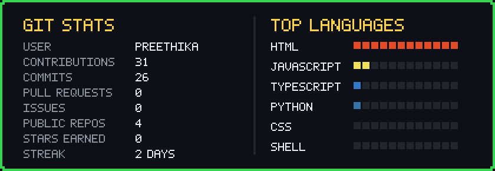

  

↑ my real contribution graph. wait a few seconds, the cat shows up.

  

| QUEST | STATUS | REWARD |
|---|:-:|:-:|
| 💸 [**wishfund-web**](https://github.com/preethikakumaravel/wishfund-web) save the links you love, split your money, level up until every wish is yours | 🟩 ACTIVE | ⭐⭐⭐ |
| 🔐 [**Escape-Rooms**](https://github.com/preethikakumaravel/Escape-Rooms) puzzles you can't leave until you solve them | 🟨 SIDE QUEST | ⭐⭐ |
| 🐛 [**autodump_caterpillar**](https://github.com/preethikakumaravel/autodump_caterpillar) a little HTML build, peek inside | 🟨 SIDE QUEST | ⭐⭐ |
| 🧠 **AI agents & memory systems** | ⬜ LOADING… | ❔ |

  
    
  INSERT COIN ⭐ to continue · every image here is generated daily by <a href="gen_pixel.py"><code>gen_pixel.py</code></a> from my real GitHub data

