<div align="center">



<sub>↑ that's my real contribution graph. wait for it.</sub>

<br/><br/>

<a href="https://git.io/typing-svg">
  
</a>

</div>

---

```console
$ whoami
preethika — builder · professional overthinker · confused but okay :)

$ cat ./now.txt
→ building   : wishfund — wishlists that save up for themselves
→ learning   : AI agents & memory systems
→ breaking   : my sleep schedule
→ ask me     : escape rooms, web dev, anything weird

$ uptime
coffee: ☕☕☕☕░  sleep: ▓░░░░  motivation: fluctuating
```

### 🧰 Things I build with

<p align="left">
  
</p>

### 🚀 Stuff worth clicking

| | Project | One-liner |
|:-:|---|---|
| 💸 | [**wishfund-web**](https://github.com/preethikakumaravel/wishfund-web) | save the links you love, split your money, level up until every wish is yours |
| 🐛 | [**autodump_caterpillar**](https://github.com/preethikakumaravel/autodump_caterpillar) | a little HTML build, peek inside |
| 🔐 | [**Escape-Rooms**](https://github.com/preethikakumaravel/Escape-Rooms) | puzzles you can't leave until you solve them |

### 📈 The numbers

<p align="center">
  
  
</p>

<details>
<summary><b>🕹️ how the name graph works</b></summary>
<br/>

A GitHub Action runs [`gen_graph.py`](gen_graph.py) every day. It pulls my real contribution calendar
from the GraphQL API and writes an animated SVG: real graph → squares ripple diagonally into my name →
back to the real graph. No fake commits, no backdating, just CSS keyframes. Respects dark mode and
`prefers-reduced-motion`.

</details>

<div align="center">
<br/>
<a href="https://www.linkedin.com/in/preethika-kumaravel-57266034a/"></a>
<br/><br/>
<sub>if you read this far, you owe me a ⭐ on something</sub>
</div>
